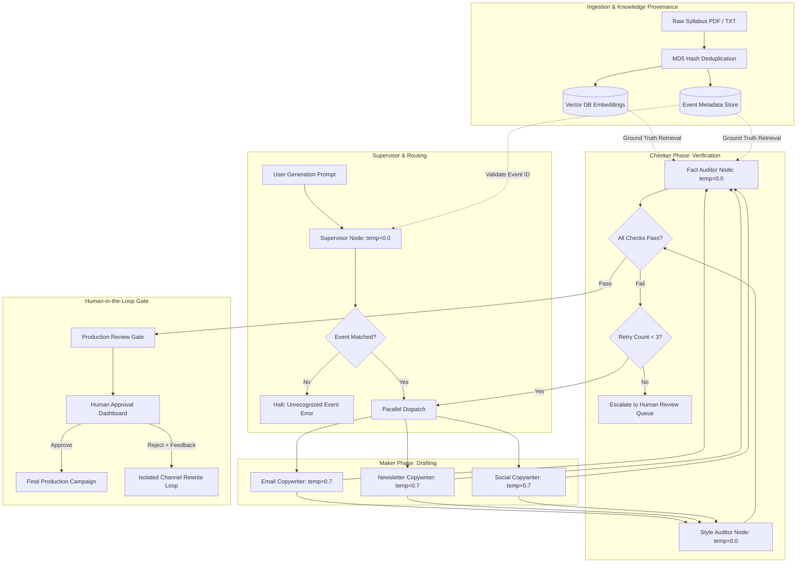

# Explainability Standard

## Overview & System Architecture
The **Marketing Campaign Swarm** is an autonomous multi-agent system designed for automated copywriting, factual validation, and multi-channel campaign orchestration. The architecture is structured as a **Supervisor-Worker Directed Acyclic Graph (DAG)** state machine coordinating distinct phases of ingestion, generation, audit verification, and human oversight.

## Decision Logic
The system implements a deterministic hierarchical decision pipeline combining semantic intent classification with rigid constraint verification:

1. **Entity Grounding & Whitelist Routing**: When an incoming campaign prompt is received, the Supervisor node queries registered event identifiers. If the prompt references an unregistered event, execution is immediately aborted with an `unrecognized_event` signal, preventing ungrounded generations.
2. **Channel Decomposition & Parallel Dispatch**: Upon entity confirmation, the workflow decomposes into target delivery channels (Email, Social, Newsletter). Execution branches concurrently to channel-specific copywriters initialized with temperature 0.7 for creative linguistic variety while constrained by structured output schemas.
3. **Dual-Temperature Calibration**: Deterministic decision nodes (Supervisor, Fact Auditor, Style Verifier, and Quality Reviewer) operate strictly at `temperature = 0.0` to eliminate non-deterministic variance and guarantee repeatable validation. Creative makers operate at `temperature = 0.7`.
4. **Iterative Audit & Circuit Breaking**: Checkers return binary pass/fail statuses with structured remediation feedback. If discrepancies are found (e.g. incorrect price or emoji violations), the targeted channel enters an automated correction loop bounded by a maximum retry ceiling of 3 attempts before escalating to human reviewers.

## Data Sources
The campaign swarm consumes verified multi-modal data streams across relational, document, and dense embedding datastores:

1. **Structured Event Metadata**: Ingests official event dates, registration fees, speaker bios, and venue information from transactional key-value and relational stores.
2. **Dense Vector Knowledge Base**: Technical course syllabi, hackathon schedules, and lecture breakdowns are chunked, embedded, and indexed in high-dimensional vector spaces for semantic similarity retrieval during copy drafting.
3. **Brand Guidelines & Policy Invariants**: Encoded formatting rules, audience-specific tones, and channel constraints (such as strict emoji ceilings and mandatory CTA layouts) provided as immutable reference configurations.
4. **Cryptographic Deduplication**: Ingested files undergo SHA-256 and MD5 hashing upon upload to prevent duplicate vector indexing and eliminate outdated knowledge pollution.

## Limitations
The platform enforces well-defined operational and regulatory boundaries:

1. **Knowledge Grounding Dependency**: The system cannot draft campaigns for events lacking ingested syllabus records. External hallucination is strictly prevented by refusing unindexed topics.
2. **Execution Boundary (No Live Dispatch)**: The agent creates and validates publication-ready copy but is intentionally disconnected from direct publishing APIs (such as live Twitter/X posting or Mailgun mailouts). Production dispatch requires human sign-off.
3. **Self-Correction Ceiling**: Automated correction loops are bounded to 3 iterations. Drafts failing repeatedly are locked into review buffers to prevent runaway token expenditure.
4. **Language Scope**: Currently optimized for English-language marketing communications. Multilingual campaigns require human translation verification before publication.
5. **Rate Limiting & Resource Constraints**: Model API invocations are throttled to 120 calls per minute with automatic exponential backoff to respect provider limits.
